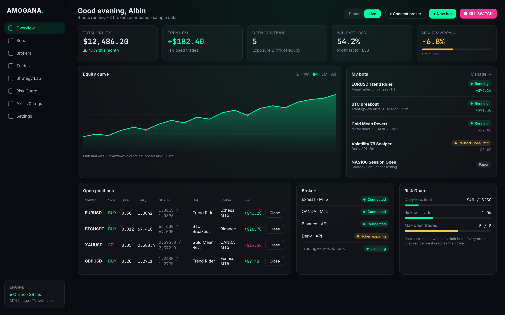

# Amogana — Auto-Trading Control Room

One dashboard to run, watch and risk-manage trading bots on **Exness
(MetaTrader 5)**, **Deriv** and **TradingView**.

- **Bots**: built-in strategy bots that trade on their own, or TradingView
  bots that execute your Pine Script alerts. Start, pause, edit, buy/sell/close
  manually, and switch each bot between **Paper** and **Live**.
- **Brokers**: Exness (and any MT5 broker) through a small bridge EA you run
  in MetaTrader 5; Deriv through its official API (Multiplier contracts).
- **Strategy Lab**: backtests on real Deriv price history, plus an optimiser
  that tunes every strategy on 70% of the data and ranks them on the 30% it
  has never seen. Deploy the winner as a paper bot in one click.
- **Risk Guard**: every order passes risk sizing (risk % per trade), a daily
  loss limit, a max-drawdown kill switch and open-trade caps before it can
  reach a broker. There is also a manual **kill switch** that pauses all bots
  and closes all positions.

> **About returns.** No strategy can guarantee profit, let alone 100% ROI,
> and anything that promises it is a red flag. The Strategy Lab exists so you
> can see how a strategy *would have* behaved, on data it wasn't tuned on,
> before risking money. Start in Paper mode, then go live small.



## How it works

```
TradingView alert ──► /api/webhooks/tradingview ─┐
Built-in strategy (each new candle) ─────────────┼─► engine: dedupe → Risk Guard → size → route
Manual button on the dashboard ──────────────────┘                                   │
                                     ┌──────────────────────┬────────────────────────┤
                                     ▼                      ▼                        ▼
                               Paper (simulated,     Deriv API (Multiplier     MT5 command queue ──► AmoganaBridge EA
                               live Deriv prices)    contracts, SL/TP)          (/api/mt5/sync)       in your terminal
```

- The **engine tick** (`/api/engine/tick`, or `/api/cron/tick` for a
  scheduler) syncs Deriv accounts, marks paper trades to market (stops and
  targets included), runs built-in bots on each newly closed candle, and
  enforces the daily-loss and drawdown limits. The open dashboard calls it
  every minute. For 24/7 trading, point a scheduler at the cron endpoint
  (see below).
- The **MT5 bridge EA** (`public/downloads/AmoganaBridge.mq5`) calls
  `/api/mt5/sync` every few seconds. It sends account info, open positions and
  closing deals, and receives queued orders, which it sizes from the risk
  amount and stop distance using the symbol's tick value. Positions opened by
  your other EAs or by hand appear too (marked "Other EA / manual"), and the
  kill switch closes them.
- Built-in bots get their candles from Deriv's free market data (e.g.
  `frxEURUSD` for Exness `EURUSDm`). Exness prices differ by a little spread,
  which matters little on H1 and above.

## Getting started (your PC or a VPS)

```bash
npm install
cp .env.example .env.local   # set APP_PASSWORD, CREDENTIALS_ENCRYPTION_KEY, CRON_SECRET
npm run build && npm start   # http://localhost:3000
```

With the Supabase variables empty, data is stored in `.data/amogana.json`.
That's ideal on a Windows VPS that also runs your MT5 terminal: one machine,
always on.

### Hosting on Vercel + Supabase

1. Add Supabase from the Vercel Marketplace (Storage → Supabase). This sets
   `NEXT_PUBLIC_SUPABASE_URL`, `SUPABASE_SERVICE_ROLE_KEY` and
   `POSTGRES_URL_NON_POOLING`. With `POSTGRES_URL_NON_POOLING` set, the app
   creates its tables on first start. Otherwise, run
   `supabase/migrations/0001_amogana_autotrade.sql` in the Supabase SQL editor.
2. Set `APP_PASSWORD`, `CREDENTIALS_ENCRYPTION_KEY` and `CRON_SECRET` in Vercel.
3. Run the bots 24/7 with a free scheduler such as cron-job.org, calling
   `https://<your-app>/api/cron/tick?key=<CRON_SECRET>` every minute.

## Connecting your accounts

Start with **demo** accounts. Every bot is created paused, in Paper mode.

### Exness (MetaTrader 5)

1. **Brokers → Exness → Generate bridge key**. Copy the Server URL and the key
   (the key is shown once).
2. Download the EA (**Download EA** button), put it in MT5's
   `MQL5/Experts` folder (*File → Open Data Folder*) and compile it.
3. In MT5, go to *Tools → Options → Expert Advisors*: allow algorithmic
   trading and *Allow WebRequest for listed URL*, then add your Server URL.
4. Attach **AmoganaBridge** to one chart, paste the URL and key, and turn on
   **Algo Trading**. The account shows **Connected** within seconds.
5. When creating a bot, use the symbol exactly as Market Watch shows it
   (e.g. `EURUSDm`, `XAUUSDm`).

Your MT5 terminal must stay running for bots to trade: use a VPS for 24/7.

### Deriv

1. At app.deriv.com, open *Account Settings → API token* and create a token
   with only the **Read** and **Trade** scopes. Amogana refuses tokens with
   Payments or Admin scopes.
2. Go to **Brokers → Deriv**, paste the token and click **Connect**. The token
   is encrypted at rest (AES-256-GCM).
3. Deriv bots trade Multiplier contracts. Stake is sized so that hitting the
   stop loses about your risk amount, and is never more than 25% of equity.
   Pick a multiplier Deriv allows for that market.

You can also trade Deriv through its MT5 accounts using the Exness steps above.

### TradingView

1. Create a **TradingView alerts** bot.
2. On the bot card, click **TradingView setup**, then copy the webhook URL and
   the alert message into your TradingView alert. Webhooks require a paid
   TradingView plan.
3. The alert action can be `buy` / `sell` / `close` (or
   `{{strategy.order.action}}`), optionally with `"sl"` and `"tp"` prices.
   Duplicate alerts (same `id`) are ignored, and opposite signals reverse the
   position.

## Before going live: checklist

- [ ] The strategy ran in Paper mode for 2–4 weeks, and the results resemble
      its Strategy Lab "unseen-data" numbers.
- [ ] Risk per trade is 0.5–1%, and the daily loss limit and max drawdown are
      set in Risk Guard.
- [ ] You tested the kill switch on a demo account.
- [ ] The MT5 terminal or VPS and the scheduler stay up when you're away.

Note: deposits and withdrawals change equity just like profit and loss. A
large withdrawal can look like a drawdown and trigger the kill switch, so
pause bots before moving money.

## Security

- The dashboard needs `APP_PASSWORD` in production (HMAC-signed, httpOnly
  session cookie). Machine endpoints authenticate separately:
  - TradingView: a per-bot passphrase, compared in constant time.
  - MT5 bridge: a per-account key; only its SHA-256 hash is stored.
  - Cron: `CRON_SECRET`.
- Broker tokens are encrypted with `CREDENTIALS_ENCRYPTION_KEY` and never
  leave the server. Supabase tables have RLS enabled with no policies, so
  only the server's service-role key can read them.
- Per-trade risk is hard-capped at 5%, and MT5 orders are capped by the EA's
  `InpMaxLots` input.

## Project structure

```
src/
  app/
    dashboard/            # Overview, Bots, Brokers, Trades, Strategy Lab, Risk Guard, Logs
    login/
    api/
      webhooks/tradingview  mt5/sync  cron/tick  engine/tick
      bots  brokers  trades  settings  kill-switch  strategy-lab  state  auth
  components/app/         # shell, live state provider, widgets
  lib/
    trading/              # engine, risk, store (Supabase or JSON file), types, symbols
    brokers/              # deriv.ts (WebSocket API), mt5.ts (bridge protocol)
    strategies/           # indicators, strategies, backtester + walk-forward optimiser
public/downloads/AmoganaBridge.mq5   # MetaTrader 5 bridge EA
supabase/migrations/      # Postgres schema
tests/                    # vitest: strategies, risk, engine, MT5 bridge
```

```bash
npm test            # unit tests
npm run typecheck
npm run lint
```
